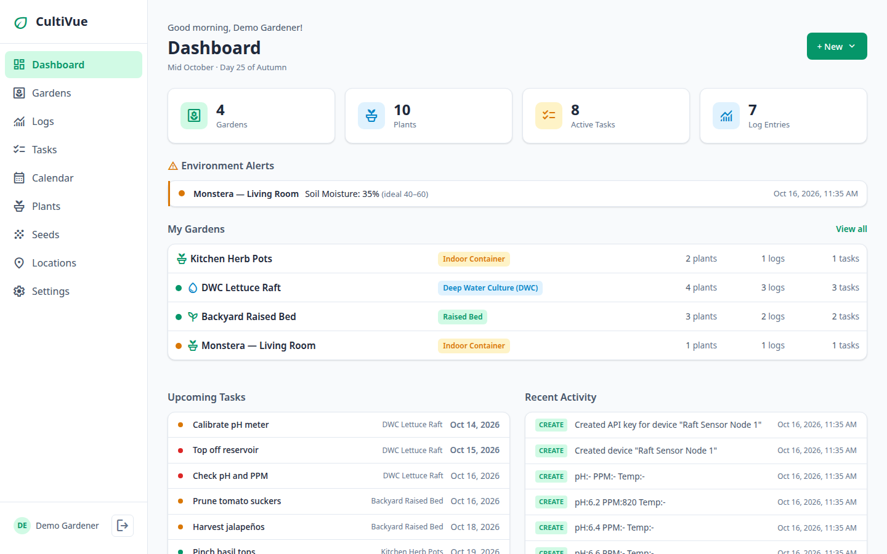
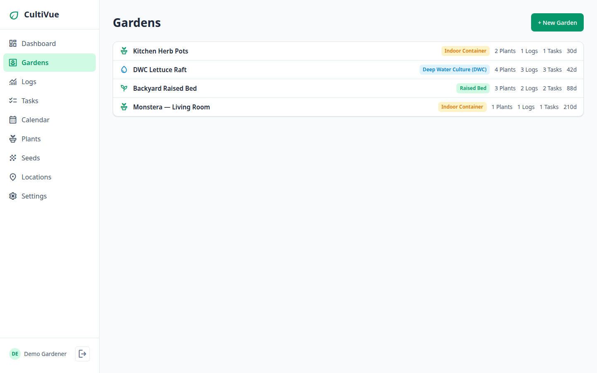
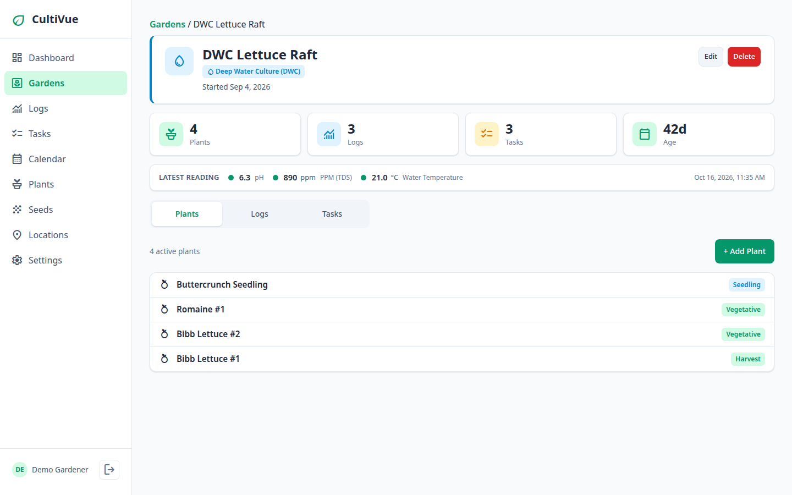
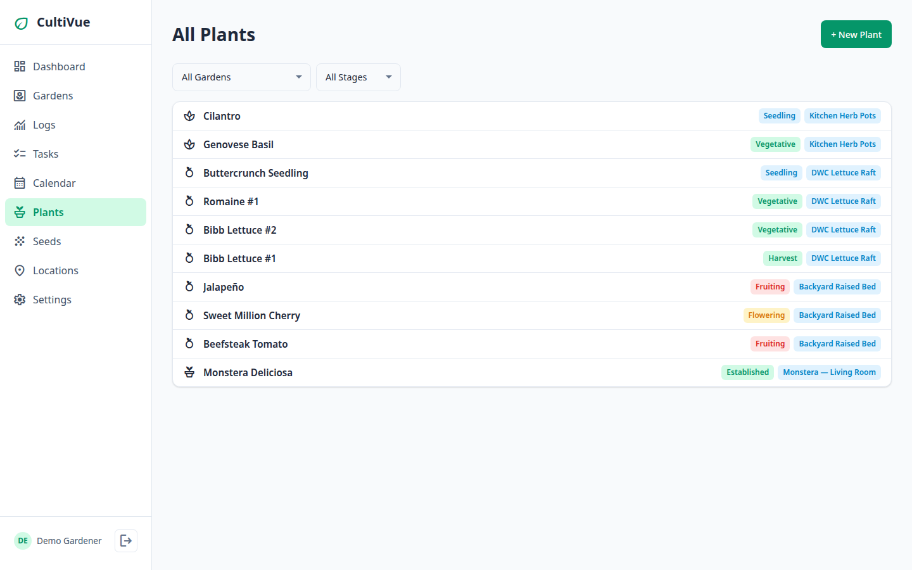
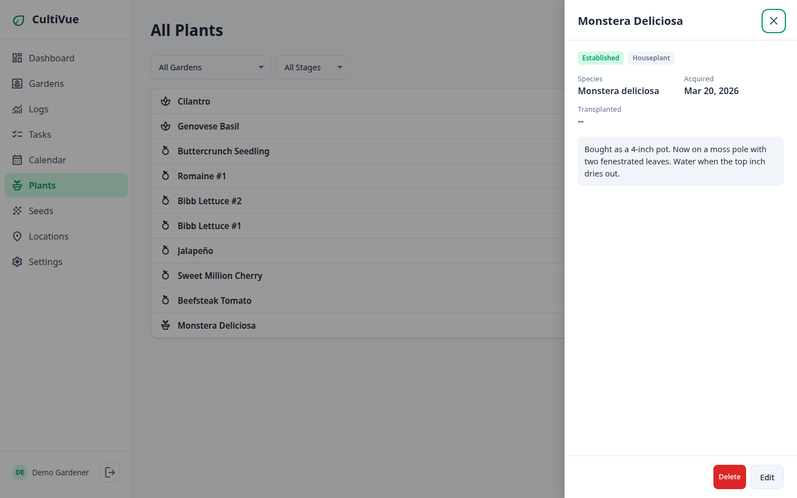
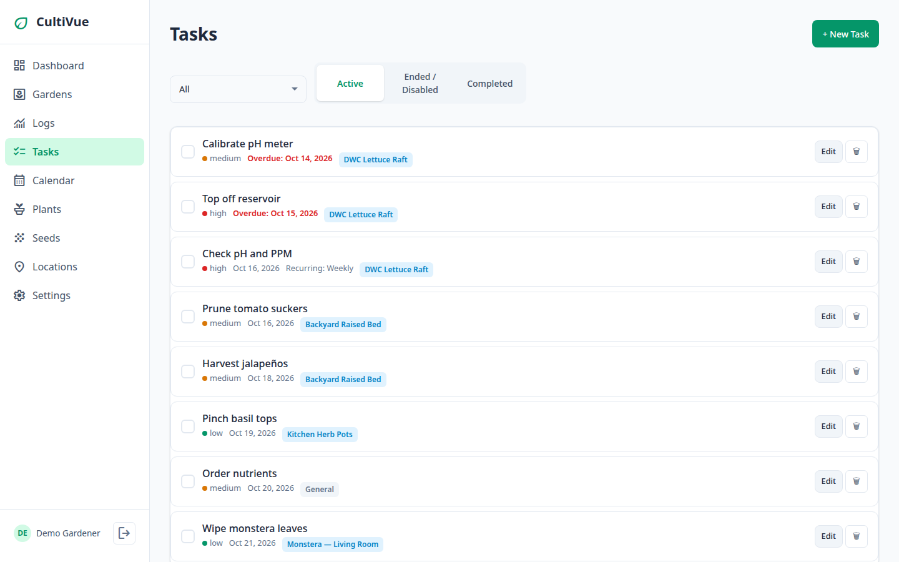
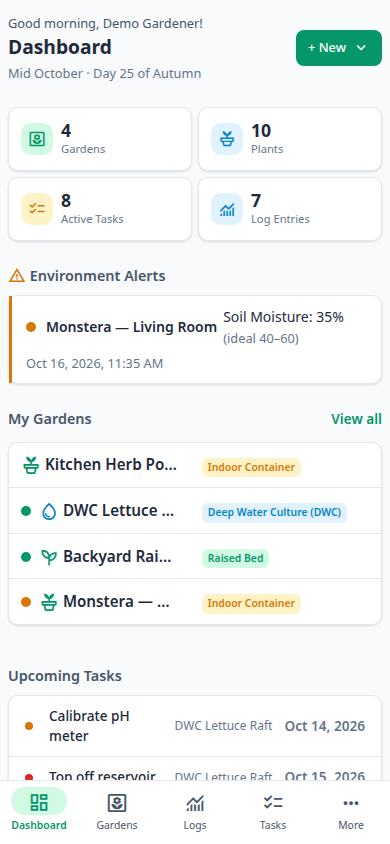
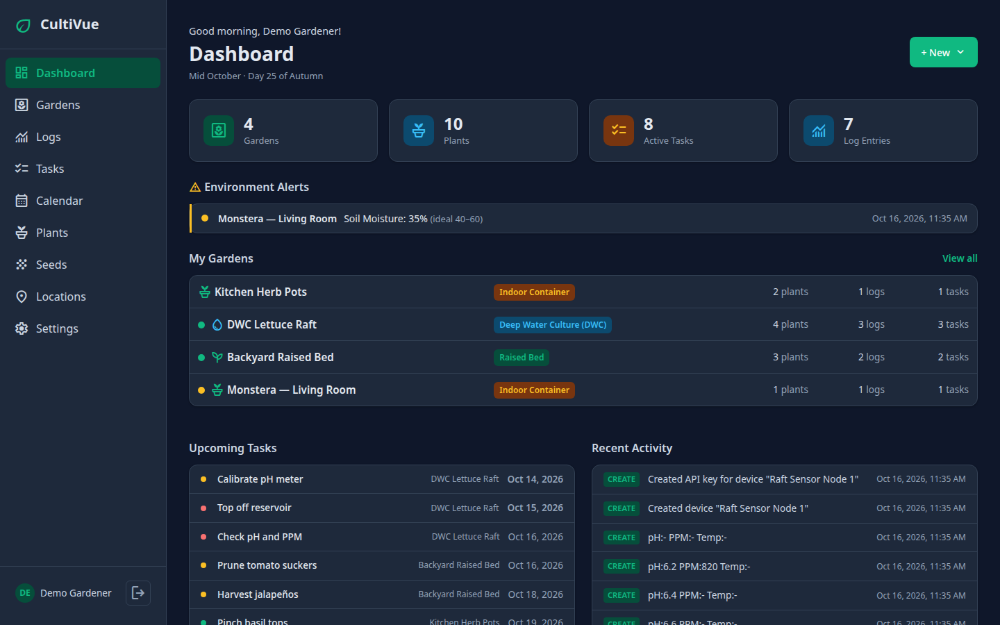
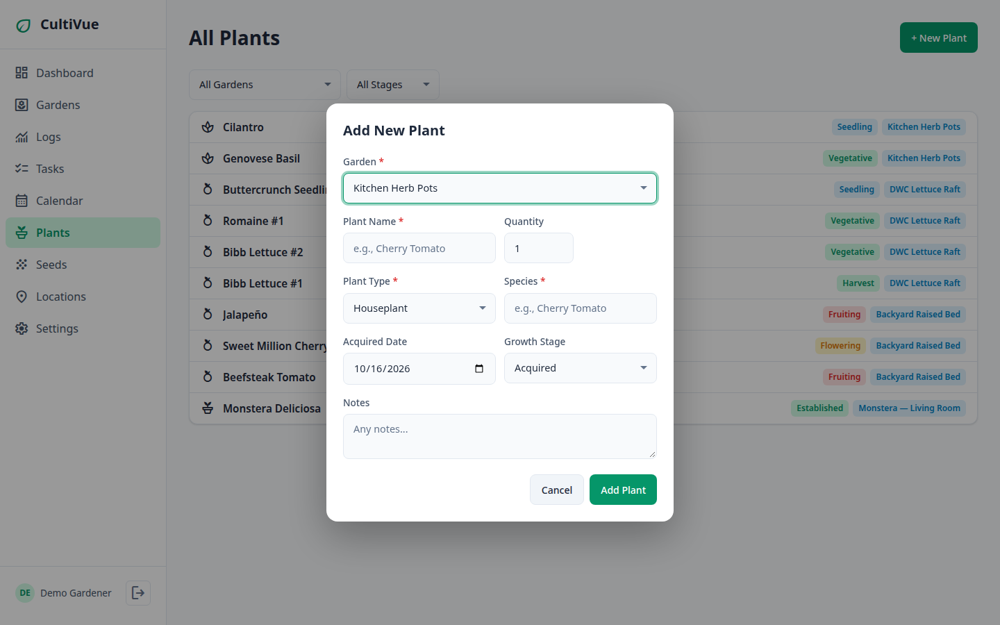

# CultiVue

A garden management web app supporting hydroponic, soil, container, and aquaponics gardens.

## Screenshots



*Dashboard — garden health, upcoming tasks, and recent activity.*



*Gardens list.*



*Garden detail — DWC Lettuce Raft with plants, logs, and tasks.*



*All Plants list across growth stages.*



*Houseplant detail — Monstera Deliciosa with its own lifecycle (acquired → acclimating → established → thriving), Acquired date, and no seed/sensor/harvest fields.*



*Tasks with priorities, overdue badges, and recurring schedules.*



*Dashboard on mobile.*



*Dashboard in dark mode.*



*Add New Plant form with Houseplant selected — the form adapts: Acquired Date instead of Seeded Date, the houseplant stage list, and seed/sensor/harvest fields hidden.*

## Features

- **Multi-garden management** with 15+ garden subtypes across 4 categories, featuring collapsible accordion panels and bulk category controls
- **Dynamic metrics** — each garden type has relevant metrics (pH, PPM, soil moisture, fish tank parameters, etc.)
- **Task management** with priorities, advanced recurring schedules (intervals, days of the week, multiple times per day), automated termination conditions (by date, run count, or garden state like empty or all harvested), disabled schedule lifecycle management, and cross-garden views
- **Plant tracking** with growth stages and harvest recording — plus a `houseplant` type with its own lifecycle (acquired → acclimating → established → thriving) for plants you buy, not sow
- **Planting calendar** — USDA hardiness zone schedules, indoor/outdoor sowing, transplanting, and harvest windows with one-click dynamic plant creation directly from calendar entry lines
- **Device & sensor integration** — register devices, generate API keys, ingest sensor readings
- **Webhook system** — fire events on sensor readings, alerts, task due dates, and harvests with HMAC signing
- **Dashboard** with health indicators, upcoming tasks, and recent activity
- **Multi-user auth** with admin-managed accounts, user deletion, account lockout, and audit logging
- **OOBE wizard** for first-time setup
- **WCAG 2.1 AA accessibility** — keyboard navigation, screen reader support, focus management
- **Dark mode** with accessible contrast ratios
- **CSV export** for logs and plants
- **Docker deployment** with persistent data volume

## Quick Start

### Docker (recommended)

```bash
docker compose up -d
```

Access at `http://localhost:8778`. The first-time setup wizard will guide you through creating an admin account and configuring the app.

### Manual

```bash
npm install
npm start
```

Runs on port 3000 by default. Set `PORT` env variable to change.

## Configuration

| Environment Variable | Default | Description |
|---|---|---|
| `PORT` | `3000` | Server port |
| `DB_PATH` | `data/cultivue.db` | SQLite database path |
| `NODE_ENV` | - | Set to `production` for secure cookies |

## Sensor API

Devices authenticate with API keys (generated in Settings > Devices).

```bash
curl -X POST http://localhost:3000/api/sensor/readings \
  -H "Content-Type: application/json" \
  -H "X-API-Key: YOUR_API_KEY" \
  -d '{"readings": [{"metric_id": "ph", "value": 6.2}, {"metric_id": "ppm", "value": 1100}]}'
```

Rate limit: 100 requests/minute per key.

## Testing

```bash
npm install
npm test
npm run test:coverage
```

## API Documentation

See [docs/api.md](docs/api.md) for the complete API reference.

## Tech Stack

- **Backend:** Node.js, Express, SQLite (better-sqlite3)
- **Frontend:** Vanilla JS, CSS custom properties, Chart.js
- **Auth:** bcrypt, session cookies, HMAC API keys
- **Security:** Helmet CSP, rate limiting, input validation, audit logging
